# Flat_Gb_bubbles Results Report

2026-11-12, updated 2026-11-16 (Study D) · Gaurav Kumar

## 1. What is in this folder

Four phase-field studies of a migrating grain boundary (GB) interacting with growing gas bubbles, all run with one solver (`src/pf_gb_bubbles_mig.cpp`) and the same material parameters. The headline result is the same in every case: isolated bubbles never pin the GB; the GB slows down only when the bubbles merge into a continuous gas layer that replaces it. Study D shows that the way bubbles coalesce (A1/Atot vs coverage) is essentially unaffected by GB motion.

| Study | Geometry | Runs | Figures |
| --- | --- | --- | --- |
| A. Flat GB + 33 bubbles | 128 × 128 × 64 box, flat GB at z = 20, Δf = 0.1 | `bubbles_only`, `gb_only_df0.1`, `coupled_df0.1` | fig1, fig2, fig3 |
| B. Round GB, no bubbles | 96³ box, spherical inner grain R0 = 32 | `sphere_nobub_df{0, 0.025, 0.05, 0.1}` | sphere_fig0, sphere_fig3 |
| C. Round GB + 25 bubbles | same sphere, 25 bubbles on it | `sphere_bub_df{0, 0.025, 0.05, 0.1}` | sphere_fig1, sphere_fig2, sphere_fig3 |
| D. Robustness of the coalescence path | as A, with θ = 128° / 104°, N = 22, Δf = 0.5, LGB = 10 | `theta128_*`, `N22_*`, `theta104_*`, `*_df0.5`, `L10_*` | fig4, fig5, fig6, fig7 |

Common model parameters: A0 = 4, bS = 1, bGB = 2.0 (contact angle θ = 120°), gradient coefficients j = jGB = 2, mobilities Ms = 0.05, Mgb = 0.5, Mb = 5, LGB = 1, gas content cInit = 0.18, bubble seed radius r0 = 4.5. The bulk driving force is F += Δf·g(n2) with g = n²(3 − 2n); grain II is the high-energy (shrinking) grain. The free GB velocity is v = LGB·jGB·Δf/γGB with γGB = 1.0724. All lengths are in grid cells and times in dimensionless units.

## 2. Study A — flat GB (Δf = 0.1) with 33 growing bubbles: setup and timing check

The bubbles reach 0.8–0.9 coverage about 8× earlier than the free GB needs to cross the box, so the two processes genuinely compete in the coupled run.

| Run | Content | Box | Duration |
| --- | --- | --- | --- |
| `bubbles_only` | 33 bubbles on a GB that cannot move (Δf = 0) | 128 × 128 × 64 | t = 0–120 |
| `gb_only_df0.1` | GB only, Δf = 0.1 (planar GB, so a 32 × 32 × 64 box is exact) | 32 × 32 × 64 | t = 0–400 |
| `coupled_df0.1` | 33 bubbles and Δf = 0.1 together | 128 × 128 × 64 | t = 0–350 |

Bubble centres are the same 33 xy positions as the N = 33 percolation study, GB and bubbles start at z = 20, shared initial condition `ic/N33_z20_c0.18.bin`.

**Timing check (independent runs)**

| Event | Run | Time |
| --- | --- | --- |
| Coverage 0.8 | bubbles only | 16.3 |
| Coverage 0.9 | bubbles only | 31.8 |
| Maximum coverage 0.974 | bubbles only | 118 |
| GB reaches z = 40 | GB only | 130 |
| GB reaches z = 60 | GB only | 260 |
| GB leaves the box | GB only | 272 |

Conclusion: with cInit = 0.18 the bubble population covers 90 % of the GB by t ≈ 32, while the free GB (velocity 0.154 cells per time unit) needs t ≈ 260 to reach the top wall. The requirement "full coverage before the GB reaches the top" is met with a wide margin. (cInit = 0.12, used in earlier studies, caps coverage at about 0.72 and would not have met it.)

## 3. Study A — GB position vs time

The bubbles do not pin the GB; the GB drags them along at 88 % of its free speed until coverage approaches 1 (t ≈ 100), after which the GB no longer exists and the grain-II front creeps forward about 6× slower than the free GB.

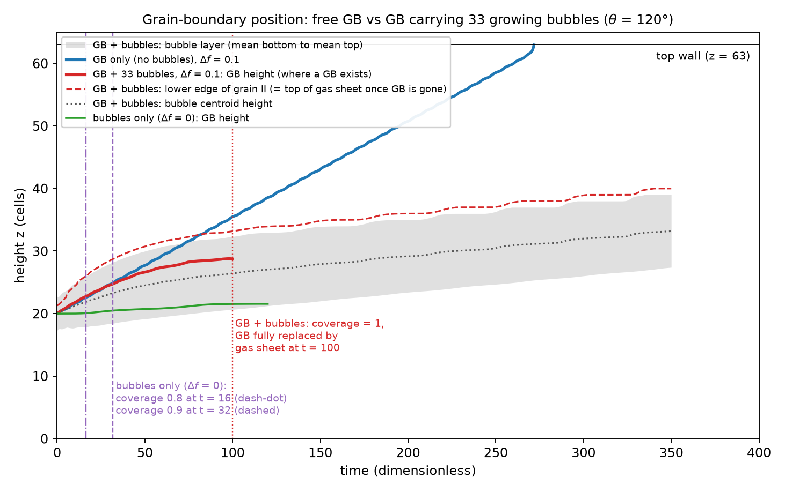

| t | Free GB z (GB only) | GB z (coupled) | Bubble centroid z (coupled) | Grain-II front z (coupled) | Coverage (coupled) |
| --- | --- | --- | --- | --- | --- |
| 0 | 20.0 | 20.0 | 20.0 | 21.3 | 0.13 |
| 10 | 21.6 | 21.8 | 21.2 | 24.4 | 0.69 |
| 20 | 23.1 | 23.3 | 22.2 | 26.8 | 0.86 |
| 30 | 24.7 | 24.6 | 23.1 | 28.5 | 0.92 |
| 40 | 26.2 | 25.7 | 23.9 | 29.8 | 0.96 |
| 60 | 29.3 | 27.4 | 25.1 | 31.5 | 0.98 |
| 80 | 32.4 | 28.4 | 25.9 | 32.6 | 0.99 |
| 100 | 35.5 | GB gone | 26.4 | 33.2 | 1.00 |
| 150 | 43.1 | — | 27.9 | 34.8 | 1.00 |
| 200 | 50.8 | — | 29.2 | 36.0 | 1.00 |
| 250 | 58.5 | — | 30.5 | 37.1 | 1.00 |
| 300 | left box (t = 272) | — | 32.0 | 38.9 | 1.00 |
| 350 | — | — | 33.2 | 40.0 | 1.00 |

GB z (coupled) is the mean height of the n1 = n2 crossing over the columns that still contain a real GB; the grain-II front is the lower edge of grain II computed from its volume (64 − V_II/128²).

| Quantity | Value |
| --- | --- |
| Free GB velocity (fit t = 10 to z = 50) | 0.154 cells per time unit |
| Coupled GB velocity while coverage < 0.94 (t ≲ 40) | 0.135 (88 % of free) |
| Columns where the GB ever broke away from a bubble | 0 of 16384, at all times |
| Coverage = 1, GB vanished | t = 100 |
| Grain-II front velocity after the GB vanished | 0.027 (6× slower than free GB) |
| Grain-II front at end of run (t = 350) | z = 40; free GB left the box at t = 272 |

Conclusions:

1. No Zener-type pinning: the GB never detaches from any bubble. Instead it carries the bubbles with it (bubble centroid 20 → 23.9 by t = 40, tops advancing with the GB, bottoms lagging). Gas relocates through the matrix (Mb = 5) faster than the GB moves.
2. Coverage 0.94 → 1 (t ≈ 40–100): only small GB necks remain between holes in the gas sheet and they fall behind the free GB (28.4 vs 32.4 at t = 80).
3. From t = 100 the bubbles form one continuous gas sheet about 10 cells thick that separates the grains. Grain II can now be consumed only by transferring gas across the sheet, at 0.027 cells per time unit. The system is effectively pinned, but by a gas layer, not by isolated bubbles.

## 4. Study A — largest bubble area / total bubble area vs coverage

The coalescence sequence is the same with and without GB motion: A1/Atot follows one staircase in coverage, and the moving GB only shifts the time at which each coverage is reached.

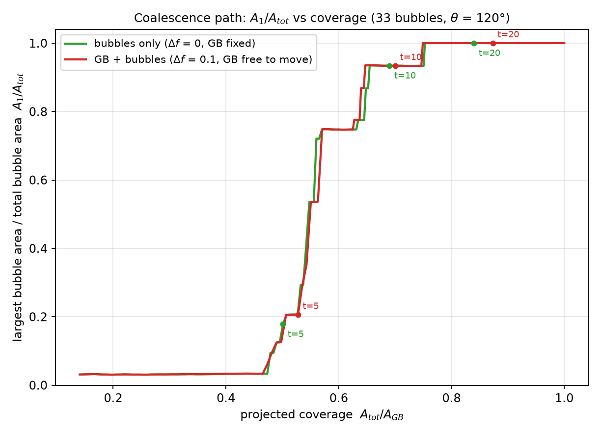

| Coverage | A1/Atot, bubbles only | N bubbles | reached at t | A1/Atot, coupled (Δf = 0.1) | N bubbles | reached at t |
| --- | --- | --- | --- | --- | --- | --- |
| 0.30 | 0.03 | 33 | 1.7 | 0.03 | 33 | 1.9 |
| 0.45 | 0.03 | 33 | 4.1 | 0.03 | 33 | 4.0 |
| 0.50 | 0.18 | 22 | 5.0 | 0.21 | 21 | 4.7 |
| 0.55 | 0.54 | 9 | 6.0 | 0.54 | 9 | 5.3 |
| 0.60 | 0.75 | 6 | 7.2 | 0.75 | 6 | 6.5 |
| 0.65 | 0.87 | 4 | 8.7 | 0.94 | 3 | 8.5 |
| 0.70 | 0.93 | 2 | 10.5 | 0.93 | 2 | 10.0 |
| 0.75 | 0.93 | 2 | 12.9 | 1.00 | 1 | 11.5 |
| 0.80 | 1.00 | 1 | 16.3 | 1.00 | 1 | 14.7 |
| 0.90 | 1.00 | 1 | 31.8 | 1.00 | 1 | 25.3 |
| maximum | 0.974 at t = 118 | 1 | | 1.00 at t = 100 | 1 | |

Conclusions:

1. First mergers at coverage ≈ 0.47 and a single connected bubble at coverage ≈ 0.75 in both runs (t = 13.0 bubbles only, t = 11.4 coupled). GB motion does not change the A1/Atot-vs-coverage curve within the resolution of the staircase. Because the GB moved only 0.73 cells during coalescence here, this was re-tested with other θ, N and much faster GBs in Study D.
2. The moving GB speeds coverage growth up by 10–20 % (0.9 at t = 25.3 instead of 31.8) because converting grain II to gas also gains Δf.
3. Without GB motion coverage saturates at 0.974; with it the last GB necks are removed and coverage reaches exactly 1 at t = 100.

fig3 shows the same story in cross-section: the GB (red) threads through the bubble row, the bubbles elongate and tilt as they are dragged, and from t ≈ 100 the slice shows a continuous black gas band with grain II above it and no red contour.

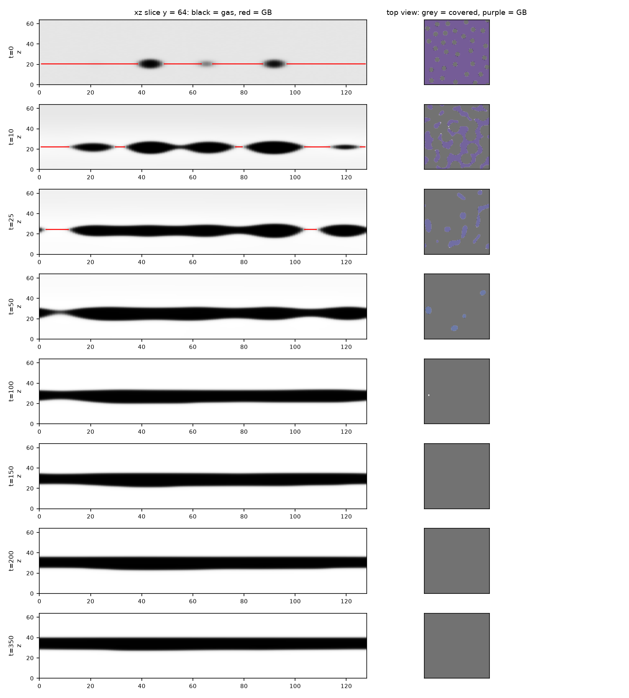

## 5. Study B — round GB, no bubbles: radius vs time

The inner spherical grain shrinks exactly as the sharp-interface law dR/dt = −Lκ(2/R + Δf/γGB) predicts, 6–7 % slower in absolute terms; Δf = 0.1 removes the grain in half the time that curvature alone needs.

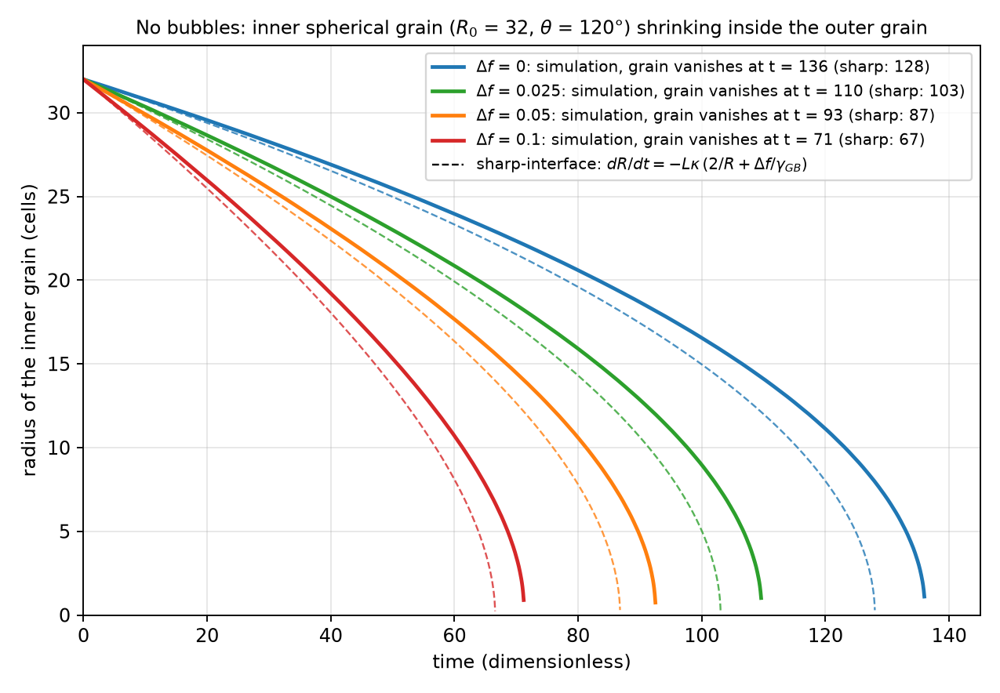

Setup: 96³ box, inner grain (grain II, the high-energy grain) of radius R0 = 32 at the box centre, surrounded by grain I. Radius = distance from the centre to the n1 = n2 crossing, averaged over 6000 uniformly distributed rays; the volume-equivalent radius agrees with it to within 0.14 cells at all times.

**GB radius (cells) at selected times**

| t | Δf = 0 | Δf = 0.025 | Δf = 0.05 | Δf = 0.1 |
| --- | --- | --- | --- | --- |
| 0 | 32.0 | 32.0 | 32.0 | 32.0 |
| 20 | 29.6 | 28.7 | 27.8 | 26.0 |
| 40 | 26.9 | 25.0 | 23.1 | 19.2 |
| 60 | 24.0 | 20.9 | 17.7 | 10.7 |
| 80 | 20.6 | 15.9 | 10.6 | gone |
| 100 | 16.6 | 9.0 | gone | |
| 120 | 11.1 | gone | | |

**Lifetime of the inner grain**

| Δf | Grain vanishes at t | Sharp-interface ODE | Simulation / ODE | R = 16 reached at t |
| --- | --- | --- | --- | --- |
| 0 | 136 | 128 | 1.06 | 102.5 |
| 0.025 | 110 | 103 | 1.07 | 79.7 |
| 0.05 | 93 | 87 | 1.07 | 65.4 |
| 0.1 | 71 | 67 | 1.07 | 48.4 |

Conclusions:

1. At Δf = 0 the shrinkage is purely curvature-driven: R² ≈ R0² − 8t, slow at first and accelerating as 2/R grows, which gives the sharp downturn at the end of every curve.
2. Δf adds a constant velocity LκΔf/γGB on top of the curvature term, so the curves start steeper and the grain disappears earlier; the ordering and spacing of the four curves match the ODE.
3. The uniform 6–7 % lag relative to the ODE is the same lattice-friction offset seen on the flat GB (0.154 measured against 0.187 predicted at Δf = 0.1) and is not a geometry effect.
4. The grain stays spherical and centred throughout (centroid offset 0; sphere_fig3, rows 1–2).

## 6. Study C — round GB with 25 bubbles

The bubbles close into a gas shell around the inner grain; the enclosed grain then shrinks 2.2–2.6× slower than a free GB and lives 1.7–1.9× longer, but it still disappears at every Δf, including Δf = 0.

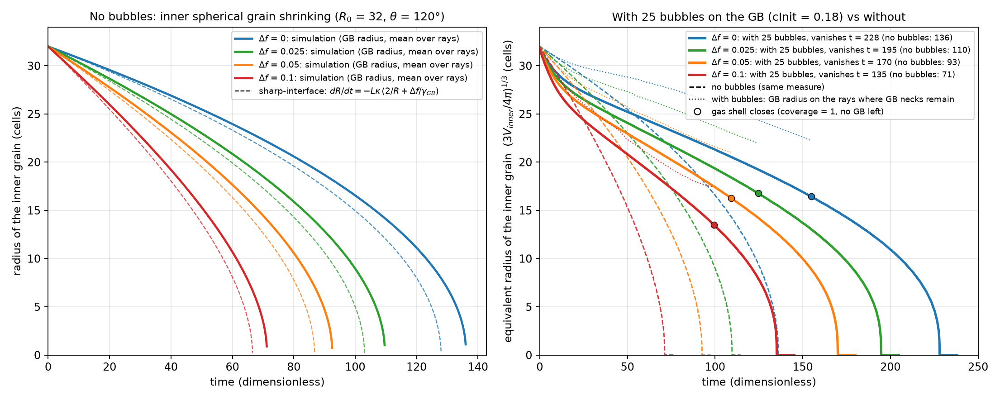

Setup: 25 bubbles with centres on the sphere r = 32 (minimum chord 19.1, same areal density as the 33 bubbles on the flat GB within 3.5 %), one shared initial condition for all Δf. Two radius measures are reported: R_vol = (3V_inner/4π)^1/3, the radius of the grain that is left inside the gas, and R_gb, the radius of the GB necks on the rays where a GB still exists.

**Inner grain radius R_vol / GB-neck radius R_gb (cells)**

| t | Δf = 0 | Δf = 0.025 | Δf = 0.05 | Δf = 0.1 |
| --- | --- | --- | --- | --- |
| 0 | 31.7 / 32.0 | 31.7 / 32.0 | 31.7 / 32.0 | 31.7 / 32.0 |
| 20 | 27.8 / 30.1 | 27.1 / 29.3 | 26.5 / 28.5 | 25.2 / 26.9 |
| 40 | 26.0 / 29.2 | 25.0 / 27.9 | 24.0 / 26.6 | 22.2 / 24.0 |
| 60 | 24.4 / 28.3 | 23.1 / 26.6 | 21.9 / 24.8 | 19.4 / 21.1 |
| 80 | 22.9 / 27.3 | 21.3 / 25.2 | 19.7 / 23.2 | 16.6 / 18.8 |
| 100 | 21.3 / 26.1 | 19.3 / 23.7 | 17.4 / 21.6 | 13.4 / no GB |
| 120 | 19.6 / 24.7 | 17.3 / 22.3 | 14.8 / no GB | 9.2 / no GB |
| 150 | 16.9 / 22.6 | 13.7 / no GB | 10.0 / no GB | gone |
| 180 | 13.7 / no GB | 8.6 / no GB | gone | |
| 220 | 6.7 / no GB | gone | | |

**Milestones**

| Δf | Single patch at t | Coverage 0.8 | Coverage 0.9 | Shell closed (coverage 1) | Grain vanishes, with bubbles | Grain vanishes, no bubbles | Ratio |
| --- | --- | --- | --- | --- | --- | --- | --- |
| 0 | 11.7 | 18.6 | 32.3 | 155 | 228 | 136 | 1.68 |
| 0.025 | 10.9 | 17.7 | 30.6 | 125 | 195 | 110 | 1.77 |
| 0.05 | 10.6 | 16.9 | 29.6 | 109 | 170 | 93 | 1.83 |
| 0.1 | 9.7 | 15.9 | 29.2 | 99 | 135 | 71 | 1.90 |

**Shrink rate of the inner grain at the same radius (cells per time unit)**

| Δf | R 20 → 15, enclosed in gas | R 20 → 15, no bubbles | Ratio | R 15 → 10, enclosed | R 15 → 10, no bubbles | Ratio |
| --- | --- | --- | --- | --- | --- | --- |
| 0 | 0.095 | 0.214 | 2.3 | 0.134 | 0.301 | 2.2 |
| 0.025 | 0.107 | 0.257 | 2.4 | 0.148 | 0.344 | 2.3 |
| 0.05 | 0.120 | 0.300 | 2.5 | 0.162 | 0.390 | 2.4 |
| 0.1 | 0.146 | 0.384 | 2.6 | 0.187 | 0.478 | 2.6 |

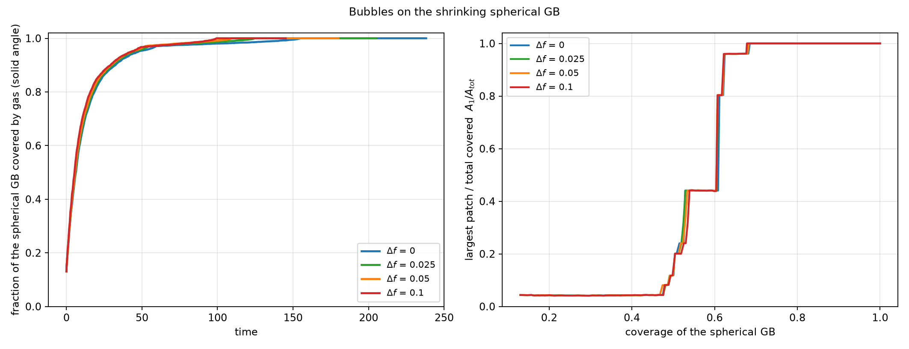

**A1/Atot vs coverage on the sphere (Δf = 0 and 0.1; the other two lie between)**

| Coverage | A1/Atot, Δf = 0 | Patches | at t | A1/Atot, Δf = 0.1 | Patches | at t |
| --- | --- | --- | --- | --- | --- | --- |
| 0.45 | 0.04 | 25 | 5.1 | 0.04 | 25 | 4.4 |
| 0.50 | 0.12 | 21 | 6.3 | 0.20 | 20 | 5.4 |
| 0.55 | 0.44 | 7 | 7.4 | 0.44 | 7 | 6.3 |
| 0.60 | 0.44 | 5 | 8.7 | 0.44 | 5 | 7.5 |
| 0.65 | 0.96 | 2 | 10.4 | 0.96 | 2 | 8.8 |
| 0.70 | 1.00 | 1 | 12.3 | 1.00 | 1 | 10.5 |
| 0.90 | 1.00 | 1 | 32.3 | 1.00 | 1 | 29.2 |

Conclusions:

1. Bubble growth and coalescence are nearly independent of Δf: the coverage(t) curves and the A1/Atot staircases of the four runs overlap (first mergers at coverage ≈ 0.47, single patch at 0.6–0.7), as on the flat GB. GB motion shifts the timing by only about 10 %.
2. Early on (t < 20) the inner grain loses volume faster with bubbles than without (R_vol 27.8 vs 29.6 at t = 20 for Δf = 0). This is gas consuming grain from the GB, not faster migration: the GB necks (R_gb) move slower than the free GB.
3. After the shell closes the inner grain is a solid sphere inside a gas layer 8–10 cells thick. It still shrinks, even at Δf = 0, because the shell's inner surface is more strongly curved than its outer surface; moving matrix material from the inner face to the outer face lowers the total surface energy. The rate is 2.2–2.6× lower than for a free GB at the same radius, and larger Δf still speeds it up.
4. As in the flat case there is no Zener-type pinning by isolated bubbles: the GB never detaches. The slowdown comes from the GB being replaced by a continuous gas layer. The difference from the flat GB is that a closed shell cannot stop a spherical grain; it roughly halves its shrink rate.

sphere_fig3 (rows 3–4) shows the sequence in cross-section: 25 bubbles on the red GB circle at t = 0, a nearly closed ring of gas at t = 25, and a thick black shell with a shrinking white core from t = 50 onward.

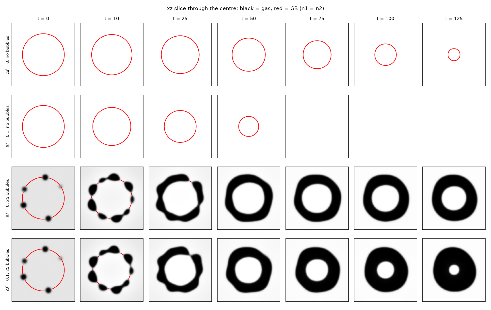

## 7. Study D — is the coalescence path independent of GB motion?

Yes for both requested cases (θ = 128°, and N = 22 bubbles): with and without GB motion their A1/Atot-vs-coverage curves agree as closely as two GB-fixed runs that differ only in kinetics. When the GB is forced to move 3–10× faster the curve shifts by about 0.02 in coverage — small, but outside that kinetics-only spread.

Why this check was needed: in Study A the GB moved only 0.73 cells while the bubbles coalesced (t = 4.3–8.3), so "unchanged by GB motion" was a weak test. Every case below is a pair of runs started from the same initial condition, one with the GB fixed (Δf = 0) and one with the GB free to migrate; the GB-only runs (no bubbles) give the free GB velocity.

| Case | θ (bGB) | Bubbles | Δf | LGB | Free GB velocity | Purpose |
| --- | --- | --- | --- | --- | --- | --- |
| Reference (Study A) | 120° (2.0) | 33 | 0.1 | 1 | 0.154 | baseline |
| Contact angle changed | 128° (1.5) | 33 | 0.1 | 1 | 0.210 | requested case 1 |
| Bubble number changed | 120° (2.0) | 22 (first 22 of the 33 sites) | 0.1 | 1 | 0.154 | requested case 2 |
| Low contact angle | 104° (3.0) | 33 | 0.3 | 1 | 0.343 | at Δf = 0.1 the free GB is lattice-pinned (stops at z = 20.58 by t = 5), so Δf was raised |
| Strong test A | 120° (2.0) | 33 | 0.5 | 1 | 0.784 | GB 5× faster, but the larger bias also changes the gas thermodynamics |
| Strong test B | 120° (2.0) | 33 | 0.1 | 10 | 1.537 | GB 10× faster with the same free energy (clean test) |

Kinetics-only spread: the GB-fixed runs with LGB = 1 and LGB = 10 have identical thermodynamics and differ only in how fast the grain fields relax. Their curves differ by at most 0.012 in coverage (median 0.005), so a shift of that size can come from kinetics alone.

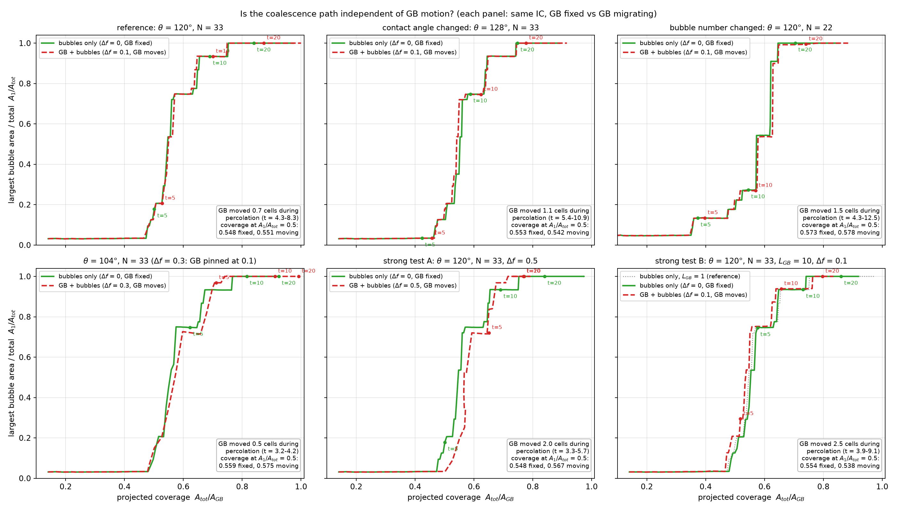

**Coalescence milestones: coverage at which each is reached (GB fixed / GB moving)**

| Case | First merger | A1/Atot = 0.25 | A1/Atot = 0.5 | A1/Atot = 0.9 | Single bubble | Single bubble, time |
| --- | --- | --- | --- | --- | --- | --- |
| Reference | 0.479 / 0.474 | 0.533 / 0.535 | 0.548 / 0.551 | 0.655 / 0.647 | 0.753 / 0.749 | 13.0 / 11.4 |
| θ = 128° | 0.466 / 0.468 | 0.536 / 0.527 | 0.553 / 0.542 | 0.645 / 0.648 | 0.743 / 0.745 | 19.5 / 16.6 |
| N = 22 | 0.355 / 0.354 | 0.525 / 0.518 | 0.573 / 0.578 | 0.622 / 0.640 | 0.646 / 0.781 | 15.0 / 25.2 |
| θ = 104°, Δf = 0.3 | 0.489 / 0.483 | 0.542 / 0.550 | 0.559 / 0.575 | 0.673 / 0.699 | 0.767 / 0.740 | 8.2 / 5.8 |
| Strong A, Δf = 0.5 | 0.479 / 0.551 | 0.533 / 0.568 | 0.548 / 0.567 | 0.655 / 0.676 | 0.753 / 0.716 | 13.0 / 7.0 |
| Strong B, LGB = 10 | 0.487 / 0.472 | 0.536 / 0.518 | 0.554 / 0.538 | 0.648 / 0.639 | 0.742 / 0.764 | 10.5 / 16.7 |

Conclusions:

1. θ = 128° and N = 22: every milestone up to A1/Atot = 0.9 agrees within 0.011 and 0.019 in coverage, the same size as the kinetics-only spread.
2. The bubble number moves the whole curve (first merger at coverage 0.35 with 22 bubbles instead of 0.47 with 33), and θ = 128° barely moves it; GB motion does not move it in either case.
3. The "single bubble" coverage of N = 22 (0.646 vs 0.781) is not a path difference: one small bubble holding about 1 % of the area stays separate longer in the moving run (A1/Atot sits at 0.99). It is a straggler after percolation.
4. Strong test A's first-merger value (0.551) is not comparable: at t ≈ 3 five extra small gas pockets appeared (count 38 > 33), which delays the count-based detection. Gas also leaves the matrix faster (porosity 0.068 vs 0.046 at t = 4), which confirms that Δf = 0.5 changes the gas thermodynamics, not only the GB speed.

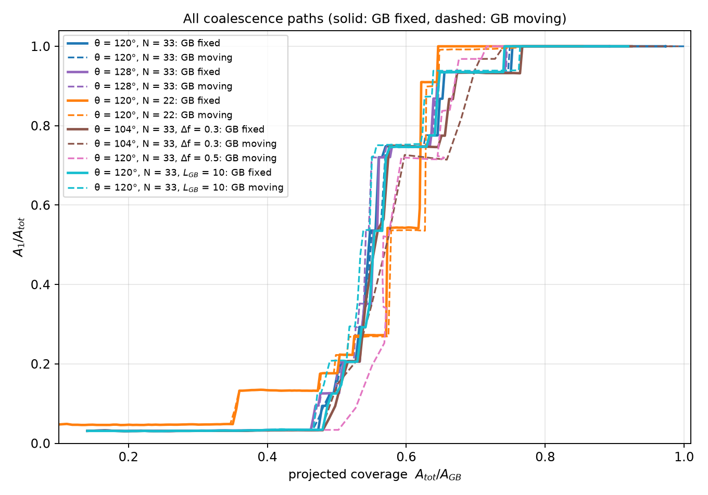

**GB motion during coalescence, and path shift**

| Case | Coalescence window (first merger → A1/Atot = 0.9) | GB moved (cells) | Free GB would move | GB speed after coalescence / free speed | Max detached columns | Path shift, median (25–75 %) |
| --- | --- | --- | --- | --- | --- | --- |
| Reference | t = 4.3–8.3 | 0.73 | 0.70 | 0.93 (t 10–25) | 0 | +0.002 (−0.003 to +0.007) |
| θ = 128° | t = 5.4–10.9 | 1.13 | 1.16 | 0.75 (t 10–40) | 0.2 % | −0.007 (−0.010 to 0.000) |
| N = 22 | t = 4.3–12.5 | 1.47 | 1.21 | 0.94 (t 10–40) | 0 | +0.005 (+0.003 to +0.007) |
| θ = 104°, Δf = 0.3 | t = 3.2–4.2 | 0.47 | 0.38 | 1.03 (t 5–20) | 0 | +0.020 (+0.009 to +0.025) |
| Strong A, Δf = 0.5 | t = 3.3–5.7 | 2.04 | 1.91 | 0.81 (t 10–30) | 18.7 % (from t ≈ 10) | +0.028 (+0.020 to +0.033) |
| Strong B, LGB = 10 | t = 3.9–9.1 | 2.49 | 7.99 | 0.15 (t 10–25) | 1.6 % | −0.020 (−0.020 to −0.018) |
| Kinetics-only spread | — | — | — | — | — | +0.005 (0.000 to +0.010), max 0.012 |

Path shift: for each A1/Atot level 0.10, 0.15, …, 0.95, the coverage at which the moving-GB run reaches it minus the coverage at which the GB-fixed run does; the median over these 18 levels is quoted, because a level that falls on a plateau edge can jump by a whole coalescence step (0.076 at A1/Atot = 0.75 in strong test B). Detached columns: covered columns in which the GB lies above the top of the bubble (bubble left behind in grain I), as a fraction of all covered columns.

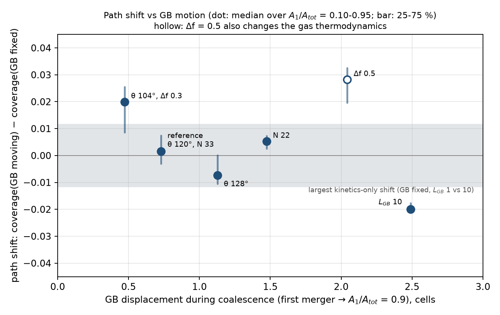

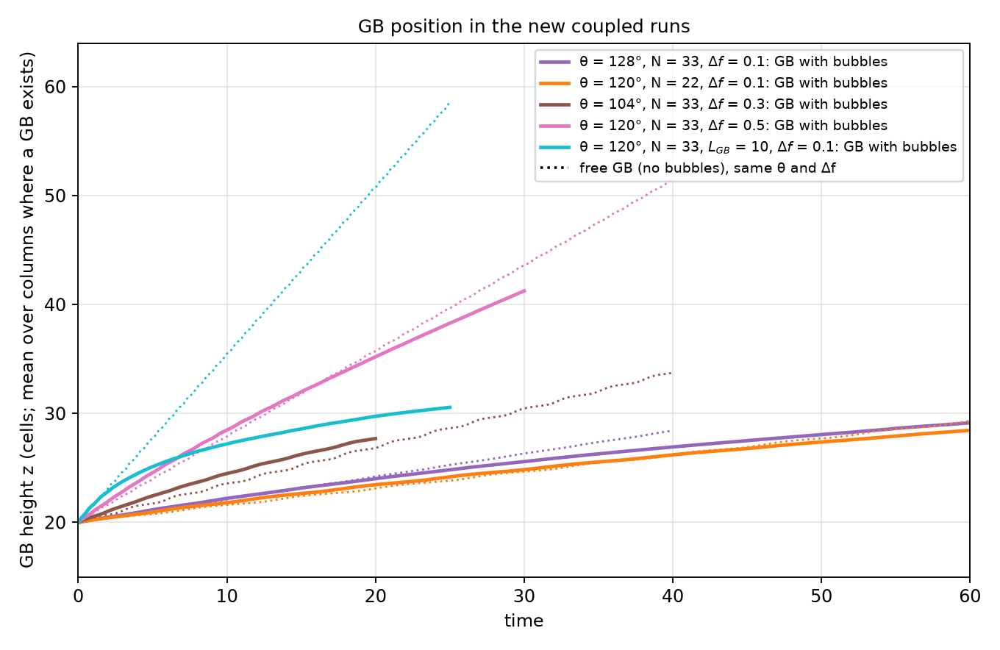

Conclusions:

1. Both requested cases confirm the result. θ = 128° and N = 22 shift the path by −0.007 and +0.005 (median), inside the kinetics-only spread, although their GB moved 1.1 and 1.5 cells during coalescence, 1.5–2× more than in the reference.
2. The strong tests show a small real effect of about 0.02 in coverage, roughly twice the kinetics-only spread. Its sign depends on the mechanism, not on how far the GB moved: a faster GB with the same thermodynamics (LGB = 10) shifts the path to lower coverage, a larger bias (Δf = 0.3, 0.5) to higher coverage. θ = 104° at Δf = 0.3 shifts by +0.020 with only 0.47 cells of GB motion, so there the bias, not the motion, is the cause.
3. Even with the largest shift, the percolation point (A1/Atot = 0.5) lies at coverage 0.54–0.58 in every run. The coalescence path is set by the bubble arrangement (N, spacing), not by GB motion.
4. Strong test B shows how strongly the bubbles drag a fast GB: it moved only 31 % of the free distance during coalescence and runs at 15 % of its free speed afterwards (0.225 vs 1.537), barely faster than the LGB = 1 reference (0.144). The GB stays attached (at most 1.6 % of columns detached), so the coupled speed is set by how fast the bubbles can follow, not by the GB mobility.
5. Strong test A is the only run with substantial breakaway: after coalescence (from t ≈ 10) the GB detaches from the bubble layer, reaching 18.7 % of covered columns by t = 30. At Δf ≤ 0.3 the GB never detaches.

## 8. Verification of all runs

Every run conserves gas to machine precision, never increases the free energy, and produced no non-finite values; the numbers in this report are therefore not affected by numerical artefacts.

| Run | max abs mass drift | Free-energy increases / outputs | Non-finite values | min c over run |
| --- | --- | --- | --- | --- |
| A `bubbles_only` | 4.9e-14 | 0 / 1200 | 0 | −0.009 |
| A `gb_only_df0.1` | no gas | 0 / 4000 | 0 | 0 |
| A `coupled_df0.1` | 2.1e-14 | 0 / 3500 | 0 | −0.028 |
| B `sphere_nobub_df0` | no gas | 0 / 4000 | 0 | 0 |
| B `sphere_nobub_df0.025` | no gas | 0 / 4000 | 0 | 0 |
| B `sphere_nobub_df0.05` | no gas | 0 / 4000 | 0 | 0 |
| B `sphere_nobub_df0.1` | no gas | 0 / 4000 | 0 | 0 |
| C `sphere_bub_df0` | 4.4e-14 | 0 / 3000 | 0 | −0.076 |
| C `sphere_bub_df0.025` | 4.3e-14 | 0 / 3000 | 0 | −0.081 |
| C `sphere_bub_df0.05` | 4.3e-14 | 0 / 3000 | 0 | −0.087 |
| C `sphere_bub_df0.1` | 4.4e-14 | 0 / 3000 | 0 | −0.099 |
| D `theta128_bubbles_only` | 4.7e-14 | 0 / 600 | 0 | −0.006 |
| D `theta128_coupled_df0.1` | 3.8e-14 | 0 / 600 | 0 | −0.023 |
| D `theta128_gb_only_df0.1` | no gas | 0 / 400 | 0 | 0 |
| D `N22_bubbles_only` | 4.7e-14 | 0 / 600 | 0 | −0.007 |
| D `N22_coupled_df0.1` | 4.9e-14 | 0 / 600 | 0 | −0.027 |
| D `theta104_bubbles_only` | 4.2e-14 | 0 / 200 | 0 | +0.003 |
| D `theta104_coupled_df0.3` | 3.4e-14 | 0 / 200 | 0 | −0.039 |
| D `theta104_gb_only_df0.3` | no gas | 0 / 400 | 0 | 0 |
| D `gb_only_df0.5` | no gas | 0 / 400 | 0 | 0 |
| D `coupled_df0.5` | 4.9e-14 | 0 / 300 | 0 | −0.170 |
| D `L10_bubbles_only` | 1.5e-13 | 0 / 300 | 0 | −0.014 |
| D `L10_coupled_df0.1` | 1.4e-13 | 0 / 250 | 0 | −0.028 |
| D `L10_gb_only_df0.1` | no gas | 0 / 250 | 0 | 0 |

Notes:

- Study D runs were shortened to save time (t = 20–60); every one reached a single bubble, and the milestones above do not depend on the end time. The θ = 104°, Δf = 0.1 GB-only run was stopped at t = 19.7 after the GB had stayed at z = 20.580 since t ≈ 10.
- Negative c is ordinary Cahn–Hilliard undershoot in the depleted matrix next to a growing bubble; c is not clamped.
- Model checks: with Δf = 0 the solver is byte-identical to the original Flat_Gb solver (checkpoint after 632 steps matches). The spherical GB radius after t = 1 (31.88) equals the sharp-interface value √(32² − 8); the two independent radius measures (ray crossing and volume) agree to 0.14 cells without bubbles.
- Restarts: `coupled_df0.1` was resumed at t = 169, and `sphere_bub_df0 / 0.025 / 0.05` at t = 147 / 123 / 142, from checkpoints; the Study D runs `theta128_*`, `N22_*` and `theta104_*` were restarted once (thread count changed). All CSVs are continuous after the restarts (0.1 spacing, no gaps or duplicate rows). The restarts were not re-verified bit for bit; the same mechanism reproduced rows exactly in the earlier percolation study.

## 9. Overall conclusions and limitations

Across flat and round geometries the bubbles never pin the GB as isolated particles; the GB drags them until they merge into a continuous gas layer, and only that layer slows the grain down.

| Question | Flat GB (Study A) | Round GB (Studies B, C) |
| --- | --- | --- |
| Does the GB detach from bubbles (Zener pinning)? | Never at Δf ≤ 0.3 (at most 1.6 % of columns, even with a 10× more mobile GB); at Δf = 0.5 the GB breaks away after coalescence (18.7 % of columns by t = 30) | Never |
| GB speed while bubbles are isolated | 88 % of free speed | GB necks slower than free GB; grain volume shrinks faster because gas eats grain |
| What happens at full coverage | Continuous gas sheet, GB gone at t = 100; grain-II front creeps at 0.027 (6× slower) | Closed gas shell at t = 99–155; enclosed grain shrinks 2.2–2.6× slower |
| Final state | Effectively pinned: front at z = 40 at t = 350, free GB left box at t = 272 | Grain still vanishes, 1.7–1.9× later than without bubbles (228 vs 136 at Δf = 0) |
| A1/Atot vs coverage | Unchanged by GB motion for θ = 120°/128° and N = 33/22 (shift ≤ 0.007, within the kinetics-only spread); shifts by about 0.02 only when the GB is forced 3–10× faster | Unchanged by Δf |
| Role of Δf | Only one value run (0.1) | Enters as a constant added velocity; ordering preserved with and without bubbles |

Why the flat and round cases end differently: a flat gas sheet has no curvature, so once the GB is gone only the Δf-driven gas transfer across the sheet remains, and that is slow. A spherical shell has an inner face more curved than its outer face, so capillarity keeps consuming the inner grain even at Δf = 0.

Limitations:

- One gas content (cInit = 0.18, chosen so the flat GB could reach 0.8–0.9 coverage; it gives a closed shell in every spherical case) and one R0. The flat-GB coalescence path was tested at three contact angles and two bubble numbers (Study D), but always with the same 33 sites (N = 22 is a subset) and one random seed.
- The bias gives the bubble interior the energy of grain I, so converting grain II to gas gains Δf; this helps bubbles follow the GB. A continuous bias cannot keep a "grain II-like" bubble.
- In the spherical runs the last ~20 time units of each curve are at R ≲ 10, only about three interface widths, and are not sharp-interface physics.
- The simulation runs 6–7 % slower than the sharp-interface GB velocity (lattice friction); all comparisons in this report are simulation-to-simulation and unaffected.

Files: `README.md` (full write-up), `results/summary.json`, `results/sphere_summary.json`, `results/robustness_summary.json`, `results/sphere_nobubbles_radius_vs_time.csv`; raw time series in `runs/*/gb_bubble.csv`, `bubble_metrics.csv`, `gb_position.csv`, `sphere.csv`.
